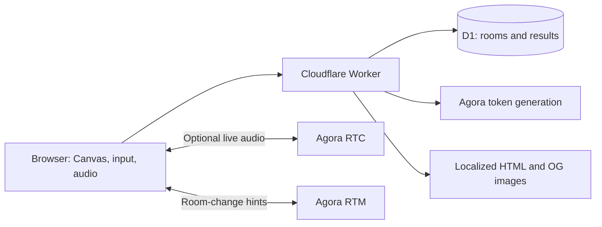

<div align="center">
  
  <p><strong>Take the candy. Don’t get caught.</strong></p>
  <p>A tiny Halloween heist for your browser. Play alone, or steal candy with friends on voice chat.</p>
  <p><a href="https://trickortake.com/">Play now</a> · <a href="docs/deployment.md">Deploy your own</a></p>
</div>

**English** · [简体中文](README.zh-CN.md) · [Español](README.es.md) · [Français](README.fr.md) · [Deutsch](README.de.md) · [日本語](README.ja.md) · [한국어](README.ko.md) · [Português (Brasil)](README.pt-BR.md)

[](https://www.agora.io/)
[](LICENSE)


[](https://trickortake.com/)

## The game

Lily is busy in the kitchen. The candy is right there. Surely she won’t notice one missing sweet?

Hold to steal. Release to hide your candy and look innocent. When Lily turns around, anyone still stealing gets a broom bonk and loses **every treat**. You have 60 seconds to see how much you can keep.

The ghost, pumpkin and bat cat are all playable. Choose one, try a solo run, or send a six-digit room code to friends. Voice is optional; the game works without it.

| Feature | What you get |
| --- | --- |
| Solo | Immediate play, local best scores, pause and resume, playful synthesized music |
| Multiplayer | 2–6 players, six-digit rooms, ready checks, shared rounds and rematches |
| Voice | Optional Agora RTC microphone chat with mute, disconnect and reconnect handling |
| Room updates | Agora RTM notifications when configured, with polling as a fallback |
| One shared challenge | Random pauses and clear turn warnings, with the same rules for everyone |
| Leaderboard | One shared ranking; submitting your name and score is always your choice |
| Challenges | Share a verified result link or download a score card |
| Mobile | Touch controls, responsive layout, home-screen icons and install manifest |
| Languages | 12 interface languages with localized page metadata; English and Chinese OG artwork |

## How to play

1. Pick a character. For multiplayer, create or join a room and let everyone get ready.
2. Hold the big button, the game scene, or **Space** to take candy. Longer holds increase your stealing speed.
3. Release when Lily starts turning. Your character immediately looks innocent, even if she is still busy.
4. Get caught and your count returns to zero. After a short stun, you can try again.
5. At the end, candy still in your hands counts too. Most candy wins; equal scores tie.

Every round lasts 60 seconds. Lily mixes short and long pauses, with 0.90–1.35 seconds of warning before she watches. There is no difficulty selector.

Timing varies each round. Lily’s next look is not sent to other players before its warning begins. Multiplayer music stays off so it does not compete with voice chat.

## Run locally

You need **Node.js 22.13 or later** and npm. The local game and room server do not require a Cloudflare account or Agora credentials.

```bash
git clone https://github.com/zicojiao/trick-or-take.git
cd trick-or-take
npm ci
npm run db:migrate
npm run dev
```

Open **http://localhost:5173**. For a quick multiplayer check, open another tab, join the same room, and ready both players. Voice requires the configuration below and microphone permission. A real two-device test is still needed to judge call quality.

The all-zero database ID in `wrangler.json` is a **local-development placeholder**. Set your own D1 ID before deploying.

### Enable Agora voice and RTM

```bash
cp .dev.vars.example .dev.vars
```

Set `AGORA_APP_ID` and `AGORA_APP_CERTIFICATE` in `.dev.vars`, then restart the dev server. Use an Agora project with RTC and Signaling/RTM enabled. The server issues short-lived tokens for authenticated room members; the App Certificate never enters a browser bundle.

Microphone access works on localhost or HTTPS. Each player must choose **Join voice** and allow the browser’s microphone prompt. See [deployment and configuration](docs/deployment.md) for production secrets and troubleshooting.

### Optional analytics

Analytics is **disabled by default** in this repository. To enable it, set your own `POSTHOG_PROJECT_TOKEN` and `POSTHOG_HOST`. The Worker exposes only this public ingestion configuration at `/config.js`.

When enabled, PostHog uses first-party cookies and local storage. Autocapture and session recording are disabled. Room codes, challenge IDs and query strings are stripped from URL properties; the application does not send player aliases in its gameplay events. Review the privacy pages for your deployment and audience.

## How it works



The frontend is plain JavaScript with a Canvas 2D renderer. The Worker serves HTML, assets, API endpoints and share images directly. There is no React framework, application build server, or external image-rendering service to run.

- **One rules engine:** `public/party/engine.mjs` drives both solo play and server-controlled rooms.
- **Server-owned multiplayer:** D1 stores room state. Conditional version updates prevent concurrent commands from silently overwriting each other. RTM carries refresh hints, not authoritative game state.
- **Verified results:** solo input traces are replayed on the server; online results come from room state. The leaderboard does not accept a client-supplied score.
- **Opt-in publication:** finishing a round does not automatically publish an alias or score. Challenge links contain result information without the player’s name.
- **Versioned rules:** older supported runs can still be verified after difficulty changes.

See [architecture and limits](docs/architecture.md) for details. Score replay rejects inconsistent results; it is not a complete defense against scripted players or abuse.

## Repository map

```text
public/party/     Game, Canvas renderer, input, voice, localization and artwork
public/          Icons, manifest, crawler files and service worker
server/          Room API, Agora tokens, score verification and OG rendering
worker/          Cloudflare request routing and localized HTML
drizzle/         Numbered D1 migrations
scripts/         Icon generation and release checks
tests/           Game rules, UI flows, API, D1, audio, sharing and localization
docs/            Deployment and architecture
```

## License

[MIT](LICENSE)
