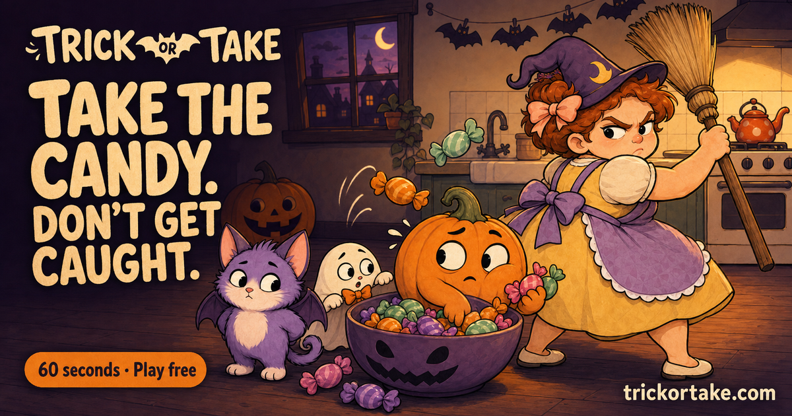

<div align="center">
  
  <p><strong>Pegue os doces. Não seja pego.</strong></p>
  <p>Uma pequena aventura de Halloween no navegador. Jogue sozinho ou com amigos no chat de voz.</p>
  <p><a href="https://trickortake.com/">Jogar agora</a> · <a href="docs/deployment.md">Guia de implantação</a></p>
</div>

[English](README.md) · [简体中文](README.zh-CN.md) · [Español](README.es.md) · [Français](README.fr.md) · [Deutsch](README.de.md) · [日本語](README.ja.md) · [한국어](README.ko.md) · **Português (Brasil)**

[](https://www.agora.io/)
[](LICENSE)


[](https://trickortake.com/)

## O jogo

Lily está ocupada na cozinha. Os doces estão bem ali. Ela não vai perceber se faltar só um, né?

Segure para pegar doces. Solte para escondê-los e fazer cara de inocente. Se Lily se virar enquanto você ainda estiver pegando, uma vassourada faz você perder **todos os doces**. Você tem 60 segundos para guardar o máximo possível.

Escolha o fantasma, a abóbora ou o gato-morcego. Jogue sozinho ou envie um código de sala de seis dígitos aos amigos. O chat de voz é opcional.

| Recurso | O que oferece |
| --- | --- |
| Solo | Recordes locais, pausa e música sintetizada |
| Multijogador | 2–6 jogadores, códigos de seis dígitos, confirmação de prontidão e revanche |
| Voz | Agora RTC com microfone, silenciamento e reconexão |
| Atualizações | Avisos do Agora RTM, com consultas periódicas como alternativa |
| Dificuldade | Três níveis; no Difícil, Lily se vira mais rápido, sem fazer isso o tempo todo |
| Ranking | Uma classificação única; você escolhe se publica seu nome e sua pontuação |
| Compartilhamento | Links para resultados verificados e cartões de pontuação para baixar |
| Celular | Controles por toque, layout adaptável e ícones para a tela inicial |
| Idiomas do jogo | Inglês em `/` e chinês simplificado em `/zh`, incluindo metadados e imagens OG |

## Como jogar

1. Escolha um personagem e a dificuldade. No multijogador, crie uma sala ou entre em uma e espere todos ficarem prontos.
2. Segure o botão grande, a cena do jogo ou a tecla **Espaço**. Quanto mais tempo segurar, mais rápido você pega doces.
3. Solte assim que Lily começar a se virar. Seu personagem imediatamente faz cara de inocente.
4. Se for pego, sua contagem volta a zero. Depois de ficar atordoado por um instante, você pode tentar de novo.
5. Quando o tempo acabar, os doces ainda nas mãos também contam. Vence quem tiver mais; pontuações iguais empatam.

| Dificuldade | Tempo de reação | Ritmo |
| --- | --- | --- |
| Fácil | 1,50–2,10 segundos | Pausas longas e aviso generoso |
| Médio | 0,90–1,35 segundo | Ritmo variado e equilibrado |
| Difícil | 0,36–0,58 segundo | Frequência parecida com Médio, movimentos muito mais rápidos |

Os tempos variam a cada rodada. O servidor não revela a próxima virada antes do início do aviso. A música fica desligada no multijogador para não atrapalhar a conversa.

## Executar localmente

Você precisa de **Node.js 22.13 ou superior** e npm. O jogo local e as salas não exigem conta da Cloudflare nem credenciais da Agora.

```bash
git clone https://github.com/zicojiao/trick-or-take.git
cd trick-or-take
npm ci
npm run db:migrate
npm run dev
```

Abra **http://localhost:5173**. Para testar uma sala, abra outra aba, entre com o mesmo código e marque os dois jogadores como prontos. Para avaliar a qualidade real do áudio, use dois dispositivos.

O ID de banco de dados preenchido com zeros em `wrangler.json` é um valor provisório para desenvolvimento local. Substitua-o pelo seu próprio ID do D1 antes de publicar.

### Ativar Agora RTC e RTM

```bash
cp .dev.vars.example .dev.vars
```

Preencha `AGORA_APP_ID` e `AGORA_APP_CERTIFICATE` em `.dev.vars` e reinicie o servidor. Ative RTC e Signaling/RTM no seu projeto da Agora. O servidor emite tokens de curta duração para participantes autenticados; o certificado nunca é enviado ao navegador.

Cada jogador precisa clicar em **Join voice** e permitir o acesso ao microfone. Use localhost ou HTTPS. Consulte o [guia de implantação](docs/deployment.md), em inglês, para configurar o ambiente de produção.

### Análise opcional

A análise fica **desativada por padrão**. Para ativá-la, configure seus próprios `POSTHOG_PROJECT_TOKEN` e `POSTHOG_HOST`. `/config.js` expõe apenas a configuração pública de recebimento de eventos.

O PostHog usa cookies próprios e armazenamento local. A captura automática e a gravação de sessões estão desativadas. Códigos de sala, IDs de desafios e parâmetros de URL são removidos dos eventos; os nomes dos jogadores não são enviados. Ajuste as páginas de privacidade para sua implantação.

## Como funciona

O cliente usa JavaScript e Canvas 2D. Um Cloudflare Worker fornece páginas, arquivos, API e imagens OG; o D1 armazena salas e resultados. O Agora RTC transmite áudio e o RTM avisa sobre mudanças na sala.

- **Motor compartilhado:** `public/party/engine.mjs` aplica as mesmas regras no modo solo e no servidor.
- **Estado controlado pelo servidor:** atualizações condicionadas à versão evitam que comandos simultâneos se sobrescrevam. O RTM não determina o estado da partida.
- **Resultados verificados:** o servidor reproduz as entradas do modo solo; os resultados multijogador vêm do estado da sala.
- **Publicação opcional:** terminar uma partida não publica automaticamente seu nome nem sua pontuação. Os links de desafio não incluem o nome do jogador.
- **Regras versionadas:** partidas de versões anteriores compatíveis continuam verificáveis após ajustes de dificuldade.

Veja a [arquitetura](docs/architecture.md), em inglês. A verificação rejeita pontuações inconsistentes, mas não impede completamente jogadores automatizados.

## Estrutura

```text
public/party/    Jogo, Canvas, controles, voz, traduções e arte
public/          Ícones, manifesto e arquivos para buscadores
server/          Salas, tokens, verificação e imagens OG
worker/          Rotas e HTML traduzido
drizzle/         Migrações D1
scripts/         Geração de ícones e verificações
tests/           Testes automatizados
docs/            Implantação e arquitetura em inglês
```

## Licença

[MIT](LICENSE)
