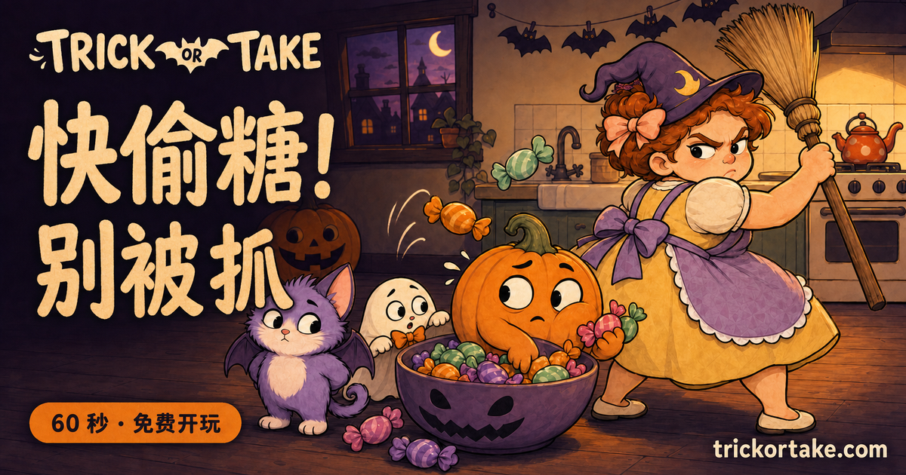
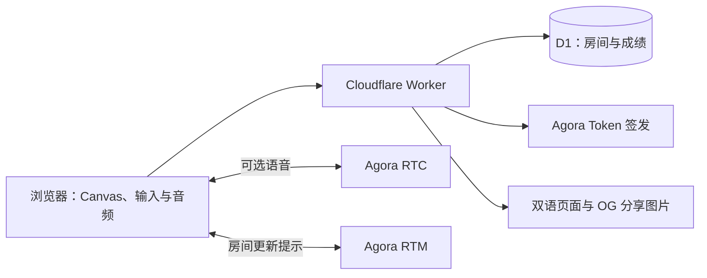

<div align="center">
  
  <p><strong>快偷糖，别被抓！</strong></p>
  <p>一个能和朋友开麦玩的万圣节偷糖小游戏。打开浏览器就能开始。</p>
  <p><a href="https://trickortake.com/zh">在线试玩</a> · <a href="docs/deployment.md">部署指南</a></p>
</div>

[English](README.md) · **简体中文** · [Español](README.es.md) · [Français](README.fr.md) · [Deutsch](README.de.md) · [日本語](README.ja.md) · [한국어](README.ko.md) · [Português (Brasil)](README.pt-BR.md)

[](https://www.agora.io/)
[](LICENSE)


[](https://trickortake.com/zh)

## 这是什么游戏？

Lily 正在厨房忙活，糖果就在眼前。只拿一颗，她应该不会发现吧？

按住偷糖，松手藏好，再摆出一副无辜的表情。Lily 回头时，如果还在偷，就会挨一记笤帚，**所有糖果清零**。一局只有 60 秒，看看你能留下多少战利品。

你可以扮演小幽灵、南瓜或蝙蝠猫，独自挑战，也可以把六位房间号发给朋友，一边开麦一边比谁偷得多。语音是可选功能，不开麦也能玩。

| 功能 | 说明 |
| --- | --- |
| 单人模式 | 即开即玩、本地最佳成绩、暂停与继续、轻松的合成背景音乐 |
| 多人模式 | 2–6 人、六位数字房间号、准备确认、同步对局和再来一局 |
| 实时语音 | Agora RTC，可加入、静音、断开与重新连接 |
| 房间消息 | 配置 Agora RTM 后使用消息通知；轮询作为后备同步方式 |
| 三档难度 | 回头间隔与速度带有随机性；困难主要考验反应速度 |
| 排行榜 | 统一榜单；是否公开昵称和成绩由玩家主动决定 |
| 分享挑战 | 生成经过服务端核验的成绩链接，或下载成绩卡片 |
| 移动端 | 触屏操作、自适应布局、主屏幕图标与安装清单 |
| 多语言 | 12 种界面语言与对应页面元数据；分享图片提供英文和简体中文版本 |

## 怎么玩？

1. 选择角色和难度。多人模式先创建或加入房间，所有玩家准备后开始。
2. 按住大按钮、游戏画面，或键盘 **空格键** 偷糖。连续按住越久，拿糖速度越快。
3. 看到 Lily 开始回头就松手。无论她有没有完全转过来，你都会立刻恢复无辜表情。
4. 被抓后糖果归零，短暂眩晕结束即可继续。
5. 倒计时结束时，手里还没藏好的糖果也会计入成绩。糖最多的人获胜，同分并列。

| 难度 | 回头预警时间 | 体验 |
| --- | --- | --- |
| 简单 | 1.50–2.10 秒 | 偷糖间隔更宽松，留出充分反应时间 |
| 中等 | 0.90–1.35 秒 | 有长有短的节奏，风险适中 |
| 困难 | 0.36–0.58 秒 | 回头次数接近中等，但转身明显更快 |

这些时间会随机变化。预警开始前，服务端不会把下一次回头时间发给其他玩家。多人房间默认关闭背景音乐，避免影响语音交流。

## 本地运行

需要 **Node.js 22.13 或更新版本** 和 npm。本地游戏与多人房间不需要 Cloudflare 账号，也不需要先配置 Agora。

```bash
git clone https://github.com/zicojiao/trick-or-take.git
cd trick-or-take
npm ci
npm run db:migrate
npm run dev
```

打开 **http://localhost:5173**。再开一个标签页、加入同一个房间并分别准备，即可快速检查多人流程。要验证真实通话质量，仍需要使用两个设备实际开麦。

`wrangler.json` 里的全零数据库 ID 是本地开发占位值，部署前必须替换成你自己的 D1 数据库 ID。

### 开启 Agora 语音与 RTM

```bash
cp .dev.vars.example .dev.vars
```

在 `.dev.vars` 中填写你自己的 `AGORA_APP_ID` 和 `AGORA_APP_CERTIFICATE`，然后重启开发服务。Agora 项目需要启用 RTC 与 Signaling/RTM。服务端只为经过验证的房间成员签发短期 Token，App Certificate 不会进入浏览器代码。

麦克风需要 localhost 或 HTTPS 环境。每位玩家还需要主动点击“加入语音”，并允许浏览器使用麦克风。生产环境配置和排查步骤见 [部署指南](docs/deployment.md)。

### 可选的数据分析

开源版本默认**不启用埋点**。填写自己的 `POSTHOG_PROJECT_TOKEN` 和 `POSTHOG_HOST` 后才能启用；Worker 通过 `/config.js` 仅提供公开的事件接收配置。

启用后，PostHog 使用第一方 Cookie 和本地存储，不开启自动采集或会话录屏。事件中的 URL 会去除房间号、挑战 ID、查询参数和片段，游戏埋点不发送玩家昵称。自行部署时，请按实际使用情况调整隐私页面。

## 技术实现



前端使用原生 JavaScript 和 Canvas 2D。Worker 直接提供页面、静态资源、API 与分享图片，不需要 React 框架、常驻应用服务器或独立的图片渲染服务。

- **共用规则引擎：** `public/party/engine.mjs` 同时用于单人模拟与服务端房间逻辑。
- **服务端决定多人状态：** D1 保存房间数据，通过版本条件更新避免并发覆盖。RTM 只通知客户端刷新，不能直接决定得分。
- **成绩核验：** 单人成绩通过服务端重放输入轨迹验证，多人成绩取自房间状态，不直接接受客户端声称的分数。
- **自愿公开：** 结束游戏不会自动公开成绩。排行榜和挑战链接需要玩家主动操作，挑战链接不包含昵称。
- **规则版本化：** 调整难度后，仍可以核验受支持的旧版本记录。

更多说明见 [架构与限制](docs/architecture.md)。服务端重放可以拒绝不一致的成绩，但不能完全阻止脚本玩家或恶意刷榜。

## 目录结构

```text
public/party/     游戏逻辑、Canvas、输入、语音、多语言与美术资源
public/          网站图标、安装清单、搜索引擎文件和 Service Worker
server/          房间 API、Agora Token、成绩核验和 OG 图片
worker/          Cloudflare 请求路由与双语 HTML
drizzle/         数据库迁移文件
scripts/         图标生成与发布检查
tests/           规则、页面流程、API、D1、音频、分享和多语言测试
docs/            英文部署与架构说明
```

## 许可证

[MIT](LICENSE)
